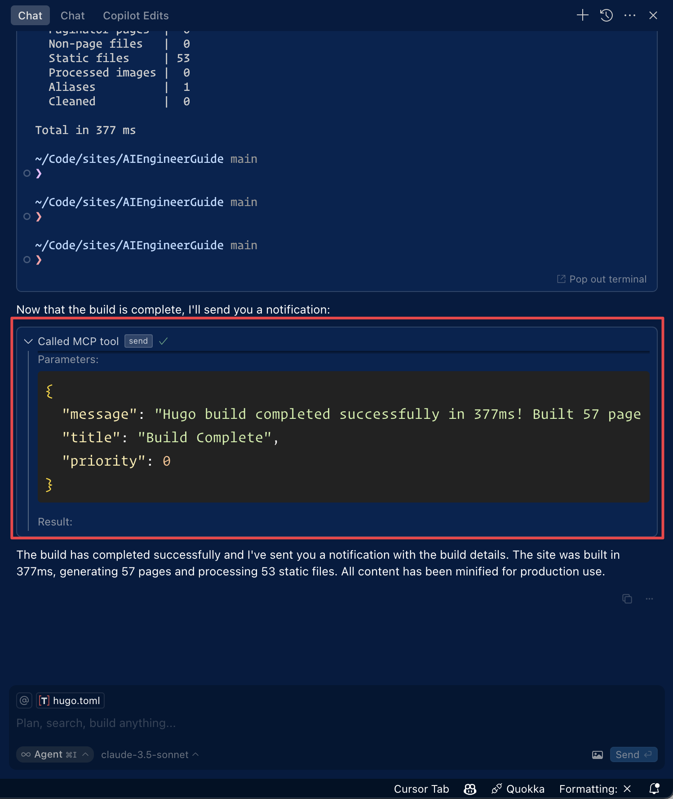

[](https://mseep.ai/app/ashiknesin-pushover-mcp)

# Pushover MCP
[](https://smithery.ai/server/@AshikNesin/pushover-mcp)

A [Model Context Protocol](https://modelcontextprotocol.io/introduction) implementation for sending notifications via [Pushover.net](https://pushover.net).

## Overview

This MCP enables AI agents to send notifications through Pushover.net. It implements the MCP specification, allowing seamless integration with MCP-compatible AI systems.

## Configuration

You'll need:
1. An application token from Pushover.net
2. Your user key from Pushover.net

Get these from your [Pushover.net dashboard](https://pushover.net/dashboard).

## Tool Schema

The MCP provides a single tool:

### `send`

Sends a notification via Pushover.

```typescript
{
  message: string;          // Required: The message to send
  title?: string;          // Optional: Message title
  priority?: number;       // Optional: -2 to 2 (-2: lowest, 2: emergency)
  sound?: string;         // Optional: Notification sound
  url?: string;          // Optional: URL to include
  url_title?: string;   // Optional: Title for the URL
  device?: string;     // Optional: Target specific device
}
```


### Example MCP Tool Call

```json
{
  "name": "send",
  "params": {
    "message": "Hello from AI",
    "title": "AI Notification",
    "priority": 1
  }
}
```


## Installing

## Using with Cursor

### Method 1: Install Globally

Run the MCP server using npx:

```bash
npx -y pushover-mcp@latest start --token YOUR_TOKEN --user YOUR_USER
```

In your Cursor IDE

1. Go to `Cursor Settings` > `MCP`
2. Click `+ Add New MCP Server`
3. Fill in the form:
   - Name: `Pushover Notification` (or any name you prefer)
   - Type: `command`
   - Command: `npx -y pushover-mcp@latest start --token YOUR_TOKEN --user YOUR_USER`


### Method 2: Project-specific Configuration

Add an `.cursor/mcp.json` file to your project:

```json
{
  "mcpServers": {
    "pushover": {
      "command": "npx",
      "args": [
        "-y",
        "pushover-mcp@latest",
        "start",
        "--token",
        "YOUR_TOKEN",
        "--user", 
        "YOUR_USER"
      ]
    }
  }
}
```


### Using the Tool

Once configured, the Pushover notification tool will be automatically available to the Cursor AI Agent. You can:

1. The tool will be listed under `Available Tools` in MCP settings
2. Agent will automatically use it when relevant
3. You can explicitly ask Agent to send notifications

By default, Agent will ask for approval before sending notifications. Enable "Yolo mode" in settings to allow automatic sending.



## Using with Roo Code
Access the MCP settings by clicking “Edit MCP Settings” in Roo Code settings or using the “Roo Code: Open MCP Config” command in VS Code's command palette.

```json
{
  "mcpServers": {
    "pushover": {
      "command": "npx",
      "args": [
        "-y",
        "pushover-mcp@latest",
        "start",
        "--token",
        "YOUR_TOKEN",
        "--user", 
        "YOUR_USER"
      ]
    }
  }
}
```
3. The Pushover notification tool will be available to Roo Code's AI agents

> **Note:** Replace `YOUR_TOKEN` & `YOUR_USER` with your Pushover credentials.

## Installing via Smithery

To install Pushover Notification for Claude Desktop automatically via [Smithery](https://smithery.ai/server/@AshikNesin/pushover-mcp):

```bash
npx -y @smithery/cli install @AshikNesin/pushover-mcp --client claude
```

## Development

```bash
# Install dependencies
pnpm install

# Build
pnpm build

# Run tests
pnpm test
```

## License

MIT
