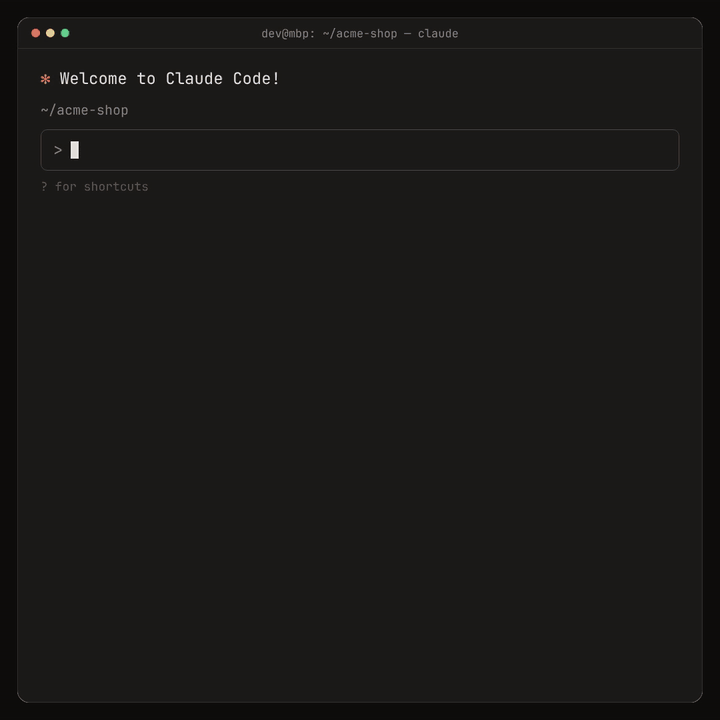

# Pushover MCP

[](https://www.npmjs.com/package/pushover-mcp)
[](https://github.com/AshikNesin/pushover-mcp/actions/workflows/ci.yml)

An [MCP](https://modelcontextprotocol.io) server that lets AI agents send push notifications to your phone and desktop through [Pushover](https://pushover.net).

<a href="media/demo.mp4"></a>

[Watch the full demo](media/demo.mp4) (30 s, MP4)

- **Rich notifications:** title, link, sound, device, HTML or monospace text, image attachments
- **Emergency alerts:** repeat until acknowledged, then check or cancel them
- **Self-correcting:** clear tool errors the agent can act on
- **stdio or HTTP:** runs locally by default, or as a shared HTTP server

## Quick start

1. Get two keys from Pushover:
   - **User key:** shown on your [dashboard](https://pushover.net/dashboard).
   - **App token:** [create an application](https://pushover.net/apps/build).
2. Add the server to your client (below), replacing `YOUR_TOKEN` and `YOUR_USER_KEY`.
3. Ask your agent to send you a notification.

Requires Node.js 22 or later.

## Setup

### Claude Code

```bash
claude mcp add pushover -e PUSHOVER_TOKEN=YOUR_TOKEN -e PUSHOVER_USER=YOUR_USER_KEY -- npx -y pushover-mcp@latest
```

### Claude Desktop, Cursor, Windsurf, Cline, Roo Code

Add this to your client's MCP config file:

```json
{
  "mcpServers": {
    "pushover": {
      "command": "npx",
      "args": ["-y", "pushover-mcp@latest"],
      "env": {
        "PUSHOVER_TOKEN": "YOUR_TOKEN",
        "PUSHOVER_USER": "YOUR_USER_KEY"
      }
    }
  }
}
```

| Client | Where to find it |
| --- | --- |
| Claude Desktop | Settings → Developer → Edit Config |
| Cursor | `~/.cursor/mcp.json`, or `.cursor/mcp.json` in a project |
| Windsurf | `~/.codeium/windsurf/mcp_config.json` |
| Cline | MCP Servers → Configure MCP Servers |
| Roo Code | Settings → MCP Servers → Edit Global MCP |

### VS Code

Add `.vscode/mcp.json`. VS Code prompts for the keys once and stores them securely:

```json
{
  "inputs": [
    { "type": "promptString", "id": "pushover-token", "description": "Pushover app token", "password": true },
    { "type": "promptString", "id": "pushover-user", "description": "Pushover user key", "password": true }
  ],
  "servers": {
    "pushover": {
      "type": "stdio",
      "command": "npx",
      "args": ["-y", "pushover-mcp@latest"],
      "env": {
        "PUSHOVER_TOKEN": "${input:pushover-token}",
        "PUSHOVER_USER": "${input:pushover-user}"
      }
    }
  }
}
```

## Tools

| Tool | What it does |
| --- | --- |
| `send_notification` | Send a notification. Returns a receipt for emergency notifications. |
| `get_receipt` | Check whether an emergency notification was acknowledged. |
| `cancel_emergency` | Stop an emergency notification from repeating, by receipt or tag. |
| `list_sounds` | List available sounds, including your custom ones. |
| `validate_user` | Check your user key and list your device names. |
| `get_limits` | Show your monthly message quota and how much is left. |

### `send_notification` parameters

Only `message` is required.

| Parameter | Description |
| --- | --- |
| `message` | Notification body, up to 1024 characters. |
| `title` | Defaults to your Pushover app's name. |
| `priority` | `-2` silent, `-1` quiet, `0` normal, `1` high, `2` emergency. |
| `sound` | Sound name from `list_sounds`. |
| `device` | Device name to target; join several with commas. Defaults to the configured default device, or all devices. |
| `url`, `url_title` | A link, and an optional label for it. |
| `html` | Render `<b>`, `<i>`, `<u>`, `<font color>` and `<a href>`. |
| `monospace` | Render in a monospace font. Can't be combined with `html`. |
| `ttl` | Seconds until the notification is deleted from devices. Ignored for emergency (priority 2). |
| `timestamp` | ISO 8601 time to show instead of the time it was received. |
| `attachment_path` | Local image to attach (jpg, png, gif, webp, heic), up to 5 MB. stdio only. |
| `attachment_base64`, `attachment_type` | Base64 image data and its MIME type. |
| `retry`, `expire` | Emergency only. Seconds between repeats (default 60, min 30) and until they stop (default 3600, max 10800). |
| `callback` | Emergency only. URL Pushover calls when you acknowledge. |
| `tags` | Emergency only. Labels for cancelling with `cancel_emergency`. |

## Configuration

Set options as environment variables or command-line flags. Flags win, but anyone on the machine can see them in process listings, so prefer environment variables for secrets.

| Environment variable | Flag | Description |
| --- | --- | --- |
| `PUSHOVER_TOKEN` | `--token` | **Required.** App API token. |
| `PUSHOVER_USER` | `--user` | **Required.** User or group key. |
| `PUSHOVER_DEFAULT_DEVICE` | `--default-device` | Device to use when a call doesn't name one. |
| `PUSHOVER_DEFAULT_SOUND` | `--default-sound` | Sound to use when a call doesn't name one. |
| `PUSHOVER_DEFAULT_PRIORITY` | `--default-priority` | Priority to use when a call doesn't set one: `-2` to `1`. |
| `PUSHOVER_MCP_TRANSPORT` | `--transport` | `stdio` (default) or `http`. |
| `PUSHOVER_MCP_HOST` | `--host` | HTTP bind address. Default `127.0.0.1`. |
| `PUSHOVER_MCP_PORT` or `PORT` | `--port` | HTTP port. Default `3000`. |
| `PUSHOVER_MCP_AUTH_TOKEN` | `--auth-token` | Bearer token HTTP clients must send. |

Run `npx pushover-mcp --help` for the full list.

## HTTP mode

By default each client starts its own server over stdio. HTTP mode instead runs one long-lived server that clients connect to by URL. Use it for hosted platforms or sharing one server between clients.

```bash
PUSHOVER_TOKEN=... PUSHOVER_USER=... npx pushover-mcp --transport http
# Listening on http://127.0.0.1:3000/mcp
```

```bash
claude mcp add --transport http pushover http://127.0.0.1:3000/mcp
# With an auth token:
claude mcp add --transport http pushover https://pushover.example.com/mcp --header "Authorization: Bearer YOUR_AUTH_TOKEN"
```

Anyone who can reach the server can send notifications with your keys, so:

- It listens on `127.0.0.1` only, and rejects requests whose `Host` or `Origin` isn't local.
- To listen on other interfaces (for example `--host 0.0.0.0`), you must set an auth token. Clients then send `Authorization: Bearer <token>`.
- `attachment_path` is turned off, so clients can't read files from the server's disk.
- For remote access, put it behind HTTPS.

```bash
PUSHOVER_MCP_AUTH_TOKEN=a-long-random-secret npx pushover-mcp --transport http --host 0.0.0.0
```

## Use as a library

```ts
import { createServer, PushoverClient } from "pushover-mcp";

// An MCP server to mount on your own transport
const server = createServer({ token, user, defaults: { sound: "bike" } });

// Or call the Pushover API directly
await new PushoverClient({ token, user }).sendMessage({ message: "Deployed" });
```

## Upgrading from v1

Existing v1 configs keep working: `start`, `--token` and `--user` are still accepted. What changed:

- The `send` tool is now `send_notification`. Agents pick up the new name automatically; update any prompts that name it.
- Node.js 22 or later is required.
- Library users: `PushoverMCP` is replaced by `createServer()`.

See the [changelog](CHANGELOG.md) for details.

## Development

```bash
pnpm install
pnpm dev        # run from source
pnpm check      # lint, typecheck, test
pnpm build
pnpm inspect    # open the server in MCP Inspector
```

## Thanks

To everyone whose reports and pull requests shaped v2:

- [@jtenniswood](https://github.com/jtenniswood) reported the Claude Desktop startup error ([#3](https://github.com/AshikNesin/pushover-mcp/issues/3)).
- [@bcdonadio](https://github.com/bcdonadio) proposed the move to the newer MCP spec ([#6](https://github.com/AshikNesin/pushover-mcp/pull/6)).
- [@craigles75](https://github.com/craigles75) proposed HTML formatting ([#9](https://github.com/AshikNesin/pushover-mcp/pull/9)).
- [@webbrain-one](https://github.com/webbrain-one) proposed the stderr logging fix ([#10](https://github.com/AshikNesin/pushover-mcp/pull/10)).
- [@punkpeye](https://github.com/punkpeye) flagged the Docker setup for the Glama directory ([#4](https://github.com/AshikNesin/pushover-mcp/issues/4)).
- [@calclavia](https://github.com/calclavia) added the original Docker setup ([#2](https://github.com/AshikNesin/pushover-mcp/pull/2)).

## License

MIT
